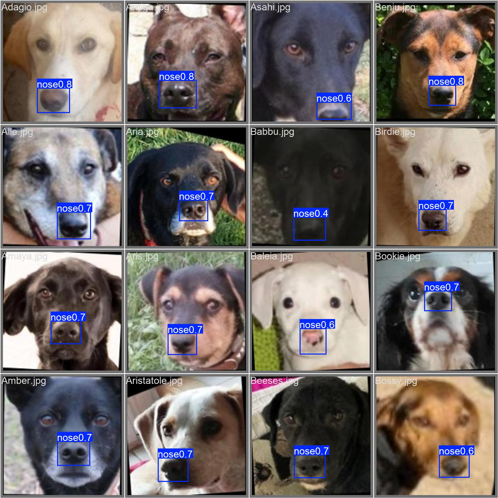
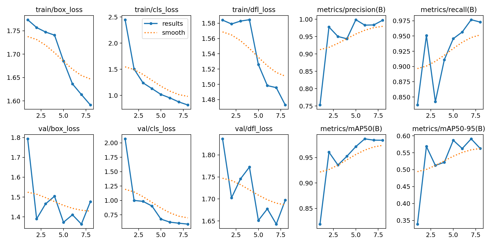
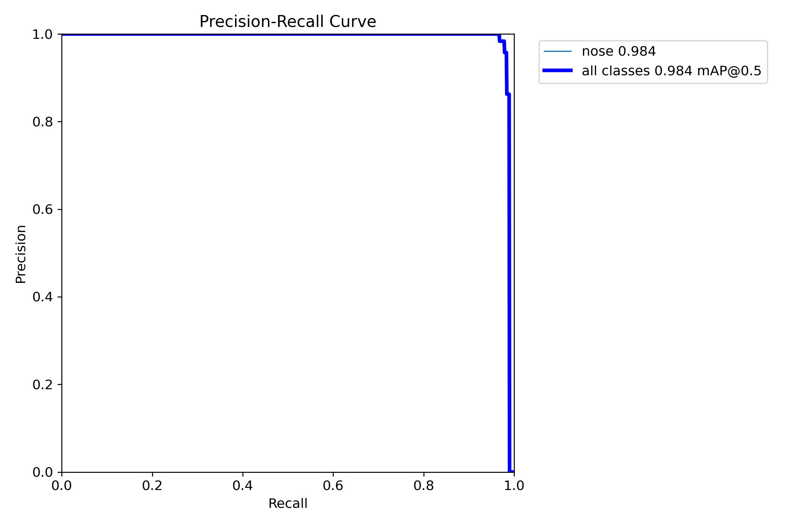

# Biometric-Pet-Identification

*Find a lost pet from a single photo — biometric pet re-identification (dog nose-print + face).*

[](https://github.com/Grechka67/Biometric-Pet-Identification/actions/workflows/ci.yml)


> **Python package / import name:** `petsy` (you'll see `import petsy` and `src/petsy/` in the code — that's
> just the short import name; the project name is the repo title above). A clean, reproducible CV project.

**Take a photo of any dog and the system helps figure out *whose* it is** — using the dog's face and
nose-print as a biometric "fingerprint," no microchip scanner required.

It's built for a real moment: from **January 2026, Bangkok requires every dog and cat to be registered
and microchipped**. But microchips need a special scanner only vets have — so an ordinary person who
finds a lost dog on the street can't read it. Biometric-Pet-Identification turns any phone into that reader.

> 📸 **The trained nose-detector, working on real photos it had never seen:**
>
> 

---

## What is this, in plain words?

Think of how your phone recognizes *your* face to unlock. Biometric-Pet-Identification does the same thing for **dogs**:
1. **Enroll** a pet → it stores a mathematical "fingerprint" of that dog's face/nose.
2. **Search** → snap a photo of a found stray, and it returns the most likely owner — or honestly says
   *"I don't recognize this one"* if the dog was never registered (so it never points to the wrong owner).

No special hardware. Works offline. Designed to plug into Thailand's pet registries later.

## Is it finished? (an honest status)

This is a **working prototype and portfolio project**, not a deployed product. Being straight about it:

| Part | State |
|---|---|
| 🟢 **Dog-nose detector** | **Real & trained** — 98.4% mAP@50 on real dog photos (see results below) |
| 🟢 **Full pipeline** (detect → match → safe verdict) | Built, tested (**25 automated tests pass**), runs on a 6 GB GPU |
| 🟢 **Web demo** (enroll / find a pet) | Working locally (FastAPI + Streamlit) |
| 🟢 **Identity re-ID — dogs (nose-print)** | **Real** — 2,000 dogs, CVPR-2022 nose-print data (ConvNeXt @160): **54% Rank-1 / 63% Rank-5**, open-set EER 0.15 |
| 🟡 **Identity re-ID — cats (face)** | Real but harder — **31% Rank-1** on 250 cats. Secondary baseline (cats lack the nose-print biometric) |

In short: **everything reported is trained on real data — no synthetic results anywhere.** The dog
nose-print re-ID is the strong result (nose-prints are a near-fingerprint biometric); cats are the honest
harder baseline. Numbers are prototype-scale and reported with their caveats, not inflated.

## Results (the detector)

Trained in ~6 minutes on a single RTX 3060 (6 GB) on 2,916 real dog photos:

| Metric | Score |
|---|---|
| mAP@50 | **0.984** |
| Precision | 0.984 |
| Recall | 0.977 |

| Training curves | Precision–Recall |
|---|---|
|  |  |

### Identity re-ID — dogs (the strong, real result)

Trained on **2,000 real individual dogs** via **nose-prints** (CVPR-2022 Pet Biometric Challenge data;
ConvNeXt-tiny @160 + ArcFace + augmentation):

| Metric | Score |
|---|---|
| Rank-1 | **0.542** |
| Rank-5 | 0.629 |
| mAP | 0.584 |
| open-set EER | 0.146 |

A dog's **nose-print is a near-fingerprint biometric**, which is why the project is dog-first and why this
beats the cat baseline so clearly.

**Honest caveats:** prototype-scale — a 2,000-dog subset (of 6,000), **1 gallery photo per dog** (more
gallery photos raise Rank-1), single seed, closed-set Rank-1 on a 1,600-dog gallery. Split is *by
individual* (no leakage). To push higher: more gallery photos/dog, nose alignment, hard-negative mining.

### Identity re-ID — cats (honest harder baseline)

Trained on **250 real cats** (face, ConvNeXt @224): **Rank-1 0.31 / Rank-5 0.43 / mAP 0.24**. Cats lack
the nose-print biometric and the data is shallow (~7 photos/cat), so this is the harder case — kept as an
honest secondary result. Improvement journey: 21% → 23% (LR) → 26% (augmentation) → 31% (ConvNeXt).

## How it works

```
phone photo
    │
    ▼
[1] Quality check   → reject blurry/dark photos before wasting effort
[2] Detect (YOLOv8) → find the dog's face + nose
[3] Embed           → turn the crop into an identity "fingerprint" (vector)
[4] Search          → compare against enrolled pets (fast vector search)
[5] Decide          → "match" / "maybe" / "not recognized"  (never guesses the wrong owner)
[6] Serve           → simple web app to enroll and find pets
```

The design choices and the research behind them are documented in [`docs/`](docs/) — including a
[literature review](docs/research/LITERATURE_REVIEW.md), [why this method](docs/research/METHOD_BENCHMARK.md),
[architecture](docs/ARCHITECTURE.md), and [decision records](docs/adr/).

## Quickstart

```bash
# 1. Environment
python -m venv .venv
.venv/Scripts/python -m pip install -U pip -r requirements-dev.txt   # (Windows path shown)

# 2. Run the tests (proves everything works)
.venv/Scripts/python -m pytest -q          # 25 passed

# 3. Try the pipeline end-to-end on synthetic data
.venv/Scripts/python scripts/sanity_check.py --head magface

# 4. Launch the web demo
.venv/Scripts/python -m streamlit run src/petsy/app.py
```

The Docker/API runtime uses the smaller CPU-only `requirements.txt`; it runs
`scripts/api.py` with ONNX Runtime and FAISS, so it does not install PyTorch.

### FAISS API runtime paths

Run the ASP.NET-integrated ONNX/FAISS API with `python scripts/api.py`. It listens on
`0.0.0.0:8000` by default. Configure `PET_AI_HOST` and `PET_AI_PORT` for server binding,
`PET_MODEL_PATH` for the ONNX weights, `PET_VECTOR_STORE_DIR` for the persistent FAISS
volume, and optionally `PET_FAISS_INDEX_PATH` / `PET_MAPPING_PATH` for separate index and
mapping files. `PET_GALLERY_DIR` configures the source images used by
`python scripts/build_gallery.py`. Relative overrides are resolved from `PET_AI_ROOT`
(which defaults to the repository root), not from the process working directory.

### Get real data (it is **not** stored in this repo — see "Data" below)
```bash
.venv/Scripts/python scripts/download_data.py --list        # see all sources
.venv/Scripts/python scripts/download_data.py --oxford-pet  # license-clean, no account
# Kaggle sets need a free API token; the script tells you how.
```
Full instructions: [`docs/RUNBOOK.md`](docs/RUNBOOK.md) · data sources: [`docs/DATA_SOURCES.md`](docs/DATA_SOURCES.md).

## Repository structure

```
src/petsy/     the library (detect, embed, match, calibrate, serve …)
scripts/       run the pipeline, download data, train the detector
tests/         automated tests (pytest)
docs/          architecture, research, decisions, runbook
configs/       training configuration
```

## Data & models — why they're not in here
Datasets and trained weights are **deliberately not committed**. Training data belongs to its original
owners (you download it yourself via the script + accept each license), and large binaries don't belong in
git. This repo ships the **code and the recipe to reproduce everything** — the professional standard.
Dataset licenses are tracked in `data/LICENSES.md` once you download them.

## Limitations (read before judging the numbers)
- Identity re-ID is **real but prototype-scale**: dogs **54% Rank-1** (2k-dog subset, 1 gallery photo/dog,
  single seed), cats 31%. Higher accuracy needs more gallery photos per individual, nose/face alignment,
  hard-negative mining, and full-dataset training. The detector (98.4%) is the most mature result.
- Synthetic data is used **only in the automated tests** (correct practice) — never in reported results.
- Prototype scale: small models, single-developer, not production-hardened.

## Tech stack
Python 3.11 · PyTorch · Ultralytics YOLOv8 · FAISS · FastAPI · Streamlit. Runs on a 6 GB GPU (or CPU).

## License & credits
Released under the [MIT License](LICENSE).
Built on open research and datasets (Oxford-IIIT Pet, and methods from the PetFace, DNNet, Nose-to-ID,
ArcFace, and MagFace papers — see [`docs/research/REFERENCES.md`](docs/research/REFERENCES.md)).
